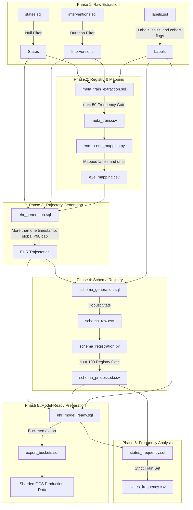

# MIMIC-IV Data Preprocessing Pipeline

This directory contains the BigQuery (SQL) and Python artifacts used to transform raw MIMIC-IV v3.1 data into a time-series EHR format for **ATLAS-EHR** pre-training. SQL outputs are materialized manually into the project tables referenced by the later scripts.

## 🚀 Preprocessing Workflow

The stages below show the data dependencies. Split restrictions are noted per script because not every gate is training-only.

> [!IMPORTANT]
> **Training-split use**: `meta_train_extraction.sql`, `schema_generation.sql`, and `states_frequency.sql` explicitly restrict their calculations to `train`. In contrast, `ehr_generation.sql` computes its `n >= 50` source-concept gate and P98 length threshold over all available raw events/trajectories.

---

## 🛡️ Data Exclusion & Health Gates

The scripts create cohort flags and apply several stage-specific gates. Most flags are not row filters in `labels.sql`.

### 1. Cohort Reliability Gates (Phase 1)
*   **Cohort flags**: `labels.sql` marks pediatric admissions, negative-length stays, and standard-cohort eligibility; it does not exclude these rows. `meta_train_extraction.sql` explicitly uses `is_standard_cohort = 1`.
*   **Non-sequential filter**: `ehr_generation.sql` removes trajectories with one or fewer distinct timestamps.

### 2. Clinical Significance Gates (Phase 2 & 4)
*   **Discovery Gate ($n \ge 50$)**: In `meta_train_extraction.sql`, concepts with fewer than 50 occurrences across the training set are excluded from mapping.
*   **Registry Gate ($n \ge 100$)**: `schema_registration.py` applies its registration rule to the schema export.

### 3. Structural Stability Gates (Phase 3 & 5)
*   **Length cap**: `ehr_generation.sql` removes trajectories above the global P98 timestamp count.
*   **Out-of-vocabulary handling**: `ehr_model_ready.sql`, not the export script, removes unmatched concepts through its inner join to `schema_processed`.
*   **Null and duration handling**: extraction removes null source values. `ehr_generation.sql` requires every intervention to have unequal start and end times; eMAR is assigned a one-minute duration, while zero-duration ICD procedures are therefore excluded from `ehr`.

---

## 🛠️ Step-by-Step Technical Details

### 1. Data Foundations
*   **[states.sql](states.sql)**: Creates admission-level age and gender states, then aggregates physiological observations from `hosp.labevents`, `icu.chartevents`, `icu.outputevents`, and weight from `inputevents`.
*   **[interventions.sql](interventions.sql)**: Captures clinical actions, including continuous infusions (`icu.inputevents`), ICU procedures, hospital medications (`hosp.emar`), and ICD procedures.
*   **[labels.sql](labels.sql)**: Defines downstream outcomes (Mortality, 30-day Readmission, LOS, DRG codes, ICD codes) and establishes the **deterministic patient-level split (80/10/10)** using `subject_id` hashing.

### 2. Semantic Mapping
The companion mapping script retains source, unit, and polarity context while assigning canonical labels:
*   **[end-to-end_mapping.py](end-to-end_mapping.py)**: Clusters concepts using **Bio_ClinicalBERT** (threshold $\ge 0.98$).
    *   **Quad-Axis Identity**: Target labels are unique per `(Canonical_Label, source_table, unit, polarity)`.
    *   **Polarity Guard**: High/Low alarms (e.g., `_hi`, `_lo`) are isolated from baseline values.

### 3. Trajectory & Robust Scaling
*   **[ehr_generation.sql](ehr_generation.sql)**: Applies mapped unit/value transforms, expands non-zero-duration interventions over the timestamp backbone, and retains trajectories with more than one timestamp through the global $P_{98}$ limit. It has no $P_2$ quantile pruning.
*   **[schema_generation.sql](schema_generation.sql)**: Calculates **Trimmed Mean/Std** based on the 5th-95th percentile to protect against outlier poisoning.

### 4. Registration & Knowledge Distillation
*   **[schema_registration.py](schema_registration.py)**: 
    *   **$n \ge 100$ Gate**: Only features with at least 100 observations in the Training set are registered.
    *   **Zero-Variance Collapse**: Forces erratic numeric signals into discrete categorical tokens.
    *   **Main Output**: `schema_processed.csv` (the immutable registry for the model).

### 5. Production Export & Sharding
*   **[ehr_model_ready.sql](ehr_model_ready.sql)**: Resolves final Vocab IDs through an inner join to `schema_processed`, broadcasts registered age/gender states only to state-containing timestamps, and clips numeric values to $P_5/P_{95}$ in its normalization expression. Current implementation caveat: the schema emits `model_type = 'NUMERIC'`, but this script tests lowercase `'numeric'`; therefore the z-score branch does not match and `val_norm` is emitted as `1.0`.
*   **[export_buckets.sql](export_buckets.sql)**: A BigQuery procedural script that iterates through 100 `bucket_id` shards per split and exports `ehr_model_ready` rows to compressed JSON Lines in Google Cloud Storage (GCS). It does not perform OOV filtering.

### 6. Guided Masking Preparation
*   **[states_frequency.sql](states_frequency.sql)**: Calculates state-event coverage frequency strictly within the Training set, restricted to timestamps containing at least one state variable. Its CSV can be consumed by downstream guided-masking logic; this SQL script does not choose masking probabilities.

---

## 🛡️ Leakage Prevention Measures
The current SQL implements the following separation behavior:

1.  **Split Isolation**: All hashing for splits is done at the `subject_id` level, ensuring no data from the same patient exists across training and evaluation sets.
2.  **Training-only calculations**: Mapping discovery, schema statistics, and state-frequency calculation use `train` as stated above. The trajectory frequency and P98 gates remain global.
3.  **Outcome separation**: Labels are stored in a separate table and are not emitted as trajectory events by these SQL scripts.
4.  **Demographic association**: Registered age and gender are broadcast only to timestamps that contain a state event; intervention-only timestamps receive no demographic broadcast.
5.  **ICD-procedure timing**: `interventions.sql` timestamps hospital ICD procedures at `23:59:59` on `chartdate`; because it gives them zero duration, `ehr_generation.sql` subsequently excludes them.

---

## Audit SQL

*   **[descriptive_stats_raw.sql](descriptive_stats_raw.sql)**: Reports split/cohort counts plus raw state and intervention vocabulary summaries.
*   **[descriptive_stats_processed.sql](descriptive_stats_processed.sql)**: Intended to report split-level trajectory, outcome, and distribution statistics from `ehr`. It expects an `ehr.num_records` field, whereas the current `ehr_generation.sql` emits `num_timestamps` and `trajectory` only; it therefore requires that field upstream before it can run unchanged.
*   **[id_label_mapping_check.sql](id_label_mapping_check.sql)**: Audits one-to-many ID/label and label/ID mappings across states and interventions.
