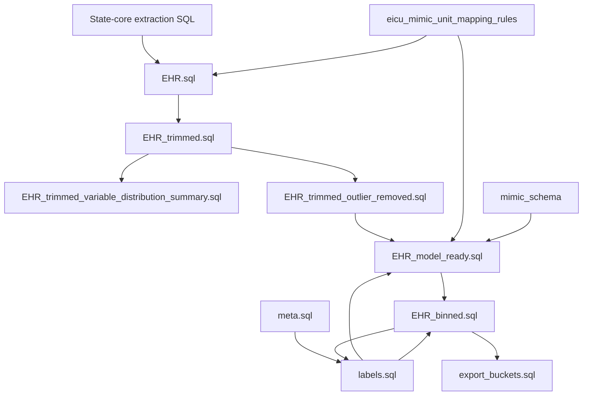

# eICU preprocessing artifacts

This directory contains BigQuery SQL and local mapping/filter artifacts for preparing eICU-CRD state events as ICU-stay trajectories aligned to an external MIMIC schema. The materialization scripts use `CREATE OR REPLACE TABLE` against `mimic-iv-484300.eICU_processed`; [`export_buckets.sql`](export_buckets.sql) exports data and [`audit/external_validation_diagnostics.sql`](audit/external_validation_diagnostics.sql) contains diagnostic queries instead.

## Inputs that must already exist

The scripts read the public `physionet-data.eicu_crd` source tables and the following project-owned inputs, which are not all produced by SQL in this directory:

* `eicu_mimic_unit_mapping_rules`: source/label conversion status, MIMIC vocabulary ID, type, unit conversion, and categorical-level rules.
* `eicu_outlier_trim_rules`: per-variable type and optional numeric lower/upper bounds.
* `mimic_schema`: MIMIC vocabulary metadata (`vid`, type, mean/std, P5/P95, and clipping flag).
* `diagnosis_labels`: the diagnosis-label table consumed by [`meta.sql`](meta.sql); no producer for it is included here.

The CSV/XLSX/JSON files in this directory are local review, mapping, and rule artifacts. Loading them into BigQuery tables is an operator step, not implemented by these SQL scripts.

## Event extraction

Each of the following creates a `*_state_core` table with `patientunitstayid`, minute-offset timestamp, label, and value:

* [`lab.sql`](lab.sql), [`customlab.sql`](customlab.sql)
* [`intakeoutput.sql`](intakeoutput.sql)
* [`nurseassessment.sql`](nurseassessment.sql), [`nursecharting.sql`](nursecharting.sql)
* [`physicalexam.sql`](physicalexam.sql), [`respiratorycharting.sql`](respiratorycharting.sql)
* [`vitalaperiodic.sql`](vitalaperiodic.sql), [`vitalperiodic.sql`](vitalperiodic.sql)

These scripts perform source-specific label/value cleaning and selective extraction. They do not by themselves impose the final cohort or vocabulary filter.

## Metadata and cohort tables

* [`patient.sql`](patient.sql) creates `patient_base` from eICU `patient`, retaining adult patients with normalized binary gender and deriving ICU/hospital mortality from discharge status.
* [`meta.sql`](meta.sql) joins `patient_base` with the externally supplied `diagnosis_labels` table and aggregates diagnosis labels and ICD-9 codes per ICU stay.
* [`admission_base.sql`](admission_base.sql) derives hospital-admission-level ICU-stay ordering, temporal-consistency flags, and a P99.5 span trim from `meta`. It is a standalone admission-level artifact and is not read by the EHR-construction SQL.

## Event-to-trajectory pipeline

The intended data flow for state events is:



* [`EHR.sql`](EHR.sql) unions the nine state-core tables, keeps only `convertible` source/label pairs, and retains adult ICU stays with known Male/Female gender, a positive ICU-discharge offset, and event timestamps within `[0, unitdischargeoffset]`. Its cohort is one ICU stay per trajectory; `admission_id` and ICU-stay order are retained as metadata.
* [`EHR_trimmed.sql`](EHR_trimmed.sql) retains ICU stays with 5–4,393 distinct timestamps, at least 10 events, and observed span no greater than 27,535 minutes.
* [`EHR_trimmed_variable_distribution_summary.sql`](EHR_trimmed_variable_distribution_summary.sql) summarizes numeric parsing, cardinality, and numeric distribution statistics from `EHR_trimmed`. It is an audit/rule-development output, not an input to later SQL here.
* [`EHR_trimmed_outlier_removed.sql`](EHR_trimmed_outlier_removed.sql) joins the outlier-rule table. It keeps categorical records and keeps numeric records only when the value parses and satisfies all supplied bounds; any source/label absent from the rules is dropped by the inner join.
* [`EHR_model_ready.sql`](EHR_model_ready.sql) resolves mapped vocabulary IDs, applies numeric multiplier/offset and optional schema clipping, emits z-scores for numeric features, maps categorical levels through its JavaScript UDF, and broadcasts age/gender to every event timestamp. Rows with a null resolved vocabulary ID or converted value are discarded.
* [`EHR_binned.sql`](EHR_binned.sql) sorts model-ready events by timestamp/order/vocabulary ID and packs one trajectory per ICU stay. It keeps `patientunitstayid`, `uniquepid`, `admission_id`, event/timestamp counts, and timestamps; the packed event struct contains only `timestamp`, `mimic_vid`, and `converted_value`.
* [`export_buckets.sql`](export_buckets.sql) exports each split and 0–99 hash bucket from `EHR_binned` as gzip-compressed JSON Lines to `gs://eicu-20260629/...`. Split and bucket ID are used for partitioning and are omitted from each exported record.

## Labels, splits, and current execution blockers

[`labels.sql`](labels.sql) creates labels from `meta` and takes `split` by joining `EHR_binned`. [`EHR_binned.sql`](EHR_binned.sql), however, takes `split` by joining `labels`. Therefore, a clean run has a circular dependency:

```text
labels.sql -> EHR_binned.sql -> labels.sql
```

[`EHR_model_ready.sql`](EHR_model_ready.sql) also reads `labels` to obtain age and gender, placing it in the same cycle. The repository does not contain a standalone split-assignment query that breaks this dependency. A pre-existing labels/binned table may permit a manual rerun, but this directory alone does not define an acyclic end-to-end execution order.

## Diagnostics and local utilities

* [`audit/external_validation_diagnostics.sql`](audit/external_validation_diagnostics.sql) provides manual BigQuery checks for split/stay counts, label prevalence, timeline ranges, duplicates, mapping coverage, sequence size, multi-ICU admissions, normalization failures, and source timestamp fallbacks.
* [`eicu_label_filter.py`](eicu_label_filter.py) filters label-summary records with coverage thresholds, clinical whitelist patterns, rare-assay exclusions, and review rules. It produces a local filtered label artifact; it does not write BigQuery tables.
* [`eICU.md`](eICU.md) is a source-table selection note, not an executable pipeline specification.

## Validation status

This README documents the checked-in SQL structure only. No BigQuery query has been executed or validated as part of this documentation update.
